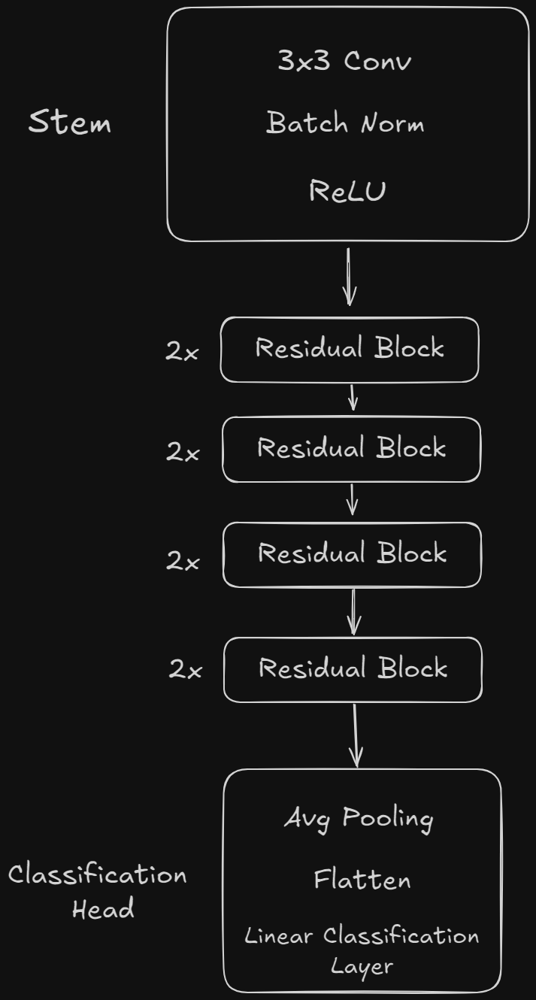

## ResNet-18 Implementation

Trained a resnet-18 based architecure model on cifar-10 dataset with custom Residual Blocks. It can predict 10 classes of images i.e. Airplanes, Cars, Trucks, Ship, Cats, Dogs, Deer, Frogs, Horse, Birds.

---

## Live Demos and Links

- HuggingFace Space:

<a href="https://huggingface.com/spaces/ahmad-777/ResNet-Implementation"></a>

- Standalone Executable: [Latest Release](https://github.com/ahmad777x86/ResNet-Implementation/releases/tag/release)

---

## Screenshots/Preview


---

## Features

- **Custom ResNet Architecture:** Native pytorch implementation with custom residual blocks.
- **Web Interface:** Web interface to interact with the model made in gradio.
- **Multiple inference runtime engines:** Native pytorch based inference for deployment and ONNX runtime engine for standalone executable.
- **Device and Platform Agnostic code:** Pytorch inference may run on CPU or GPU and is equipped with JIT-Compilation for linux or WSL platforms.

---

## Architecture

Below is a visual of the model's architecture:



The residual blocks in the diagram have the following structure within them:
- 2 Convolution layers
- 2 Batch Normalization layers
- 2 RELU
- 1 Skip connection

Skip connection here means that data skips passing through some layers and gets added to the output.

---

## Local Setup and Development

### Prerequisites
- Python 3.10+
- Pytorch/torchvision
- OpenAI Triton on WSL or Linux (Optional)
- ONNX runtime (Optional)

> [!NOTE]
> Triton on WSL or Linux is only required if you want to optimise the model to extreme with JIT Compilation. 
> ONNX runtime is only required if you want to utilise onnx based inference. 
> I don't recommend creating another exe as it is a very hectic task and you may need to deal `pyinstaller` and write manual hooks > to ensure no raw memory collision occurs. 

### Run locally:
```bash
# 1. Clone repository
git clone https://github.com/ahmad777x86/ResNet-Implementation
cd "ResNet Implementation"

# 1. Install dependencies
pip install -r requirements.txt

# 2. Launch local Gradio interface
python app.py
```

---

## References & Background

The architecture implemented in this project is based on the following paper:
- **Paper:** Deep Residual Learning for Image Recognition
- **Authors:** Kaiming He, Xiangyu Zhang, Shaoqing Ren, Jian Sun
- **ArXiv:** [1512.03385](https://arxiv.org/abs/1512.03385) 

## License

- MIT 